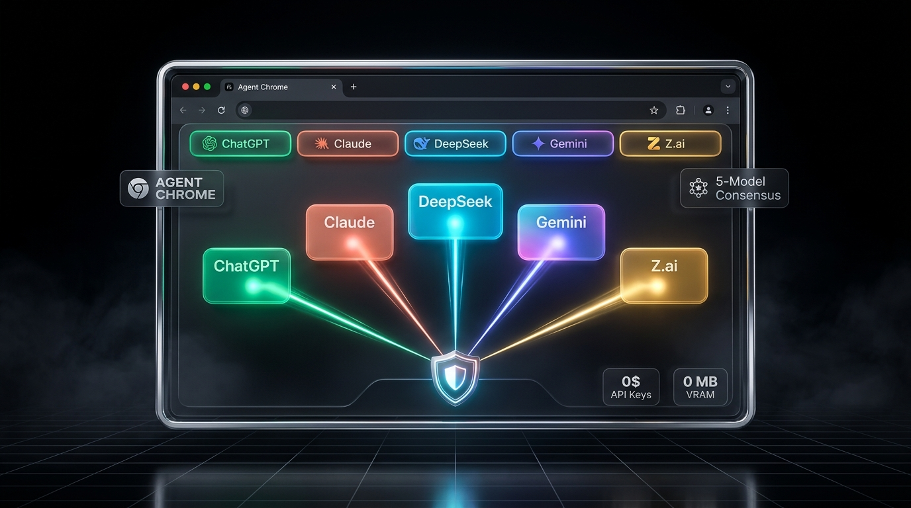
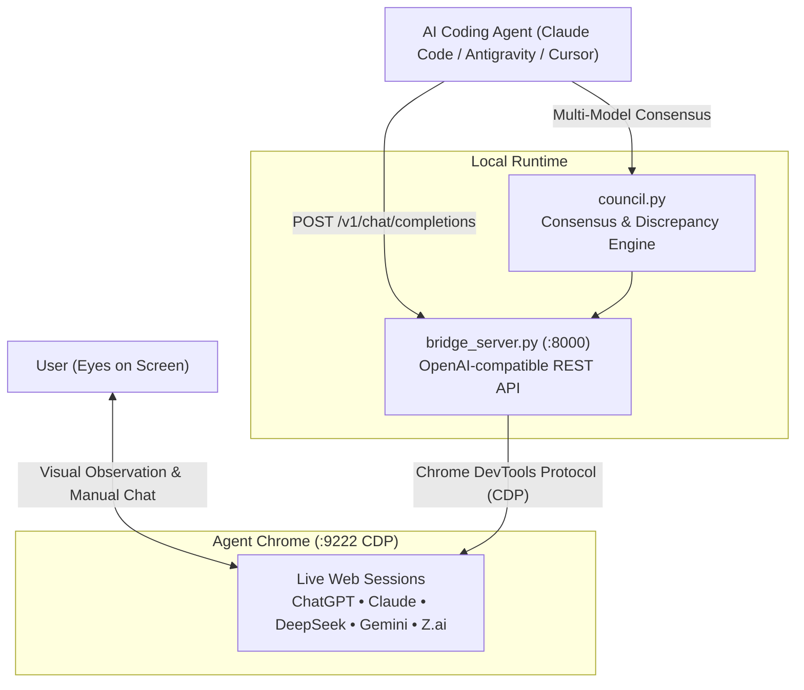

# Agent Chrome 🌐⚡

[](LICENSE)
[](https://www.python.org/downloads/)
[]()
[]()



> **An open agent skill that turns your existing logged-in browser tabs into a zero-cost Multi-LLM Consensus Council.**  
> Zero API keys. Zero token bills. Zero GPU VRAM. 100% visible on your desktop.

---

## The Problem

Coding agents (Claude Code, Antigravity, Codex, Cursor, OpenCode) are only as reliable as the single model powering them. Single models suffer from:
1. **Blind spots & hallucinated APIs** that go unnoticed until runtime.
2. **Exorbitant API costs**: Paying \$20–\$100+ / month for Anthropic, OpenAI, and DeepSeek tokens even though you already have web subscriptions (ChatGPT Plus, Claude Pro, Gemini Advanced, or free DeepSeek R1).
3. **Heavy VRAM footprints**: Local models consume 6GB–16GB of GPU memory, starving your IDE and vision systems.

**Agent Chrome** solves this by bridging your coding agent to a dedicated, visible desktop Chrome browser window running your existing web sessions. You can watch prompts stream into the tabs with your own eyes in real time.

---

## Key Features

- 🎯 **Frontier 6-Model Consensus**: Queries **Claude Sonnet 3.5/5.5**, **DeepSeek R1**, **ChatGPT**, **Google Gemini**, **Z.ai GLM-5.3**, and **Moonshot Kimi K3** in parallel or sequence.
- 🔥 **Hostile Technical Audit (`--audit`)**: Strips LLM politeness and "yes-man" sycophancy. Forces all models into adversarial auditor mode to uncover fatal bugs, bottlenecks, and unhandled edge cases.
- 🏆 **Automated Consensus Synthesis (`--synthesize`)**: Cross-examines all outputs and delivers a 3-part Verdict: **Consensus Truth**, **Clashing Contradictions**, and the **Winning Synthesized Solution**.
- 📎 **Multimodal Deliverable Attachments**: Send images (`.png`, `.jpg`), documents (`.pdf`, `.docx`), slide decks (`.pptx`), spreadsheets (`.xlsx`, `.csv`), and code files directly to all models in your browser.
- 👁️ **100% Visible & Unrestricted**: Agent Chrome is a normal, visible desktop browser window. No hidden background processes. You can inspect tabs, click around, and chat yourself at any time.
- 💰 **Zero API Costs**: Uses your existing browser logins. No credit card, no prepaid tokens, no rate surprise.
- 🧊 **Zero Local GPU VRAM**: Runs entirely inside Chrome renderers or remote provider servers. Leaves 100% of your RTX / Apple Silicon GPU free.
- 🔌 **OpenAI-Compatible Local Endpoint**: Exposes a standard `http://127.0.0.1:8000/v1/chat/completions` endpoint. Drop it into *any* framework (LangChain, AutoGen, CrewAI, LlamaIndex, LiteLLM) by changing `base_url`.
- 🛡️ **Self-Healing DOM Engine**: Compares message node counts, tracks turn state, auto-recovers from identical consecutive prompts, and detects settled text.

---

## Architecture



---

## Quick Start (3 Minutes)

### 1. Clone & Install
```bash
git clone https://github.com/Razae786/agent-chrome.git
cd agent-chrome

# Install dependencies
pip install -r requirements.txt
```

### 2. Run Diagnostics
Before starting, run the built-in doctor to verify your environment:
```bash
python scripts/doctor.py
```

### 3. Launch Agent Chrome
Launch your dedicated visible browser:
- **Windows**: Double-click `scripts\launch_agent_chrome.bat` (or `.ps1`)
- **macOS / Linux**: `bash scripts/launch_agent_chrome.sh`

> **Note**: On first launch, log into each web service (ChatGPT, Claude, DeepSeek, Gemini, Z.ai). Because it uses a persistent profile (`~/.agent-chrome-profile`), your logins remain saved across sessions.

### 4. Start the Bridge Server
```bash
python engine/bridge_server.py
```
The server will connect over CDP to `127.0.0.1:9222` and start listening on `http://127.0.0.1:8000`.

### 5. Query the Consensus Council
```bash
# Query all 6 models simultaneously
python engine/council.py -q "What are the common failure modes of SQLite WAL mode in multiprocessing?"

# Run Hostile Technical Audit (strips politeness, hunts fatal bugs)
python engine/council.py -q "Audit our edge caching architecture for memory leaks" --audit

# Audit + Automated 3-Part Consensus Synthesis (Consensus Truth, Contradictions, Winning Fix)
python engine/council.py -q "Review this database migration strategy" --audit --synthesize

# Query with deliverable attachments (images, PPTX, PDFs, documents)
python engine/council.py -q "Expose all weaknesses in this slide deck" -f defense.pptx diagram.png --audit
```

---

## Agent Installation

### For Claude Code
Add to your project's skills directory:
```bash
cp -r plugins/agent-chrome/skills/agent-chrome ~/.claude/skills/
```
Or via plugin:
```bash
claude --plugin-dir ./plugins/agent-chrome
```
Then ask Claude Code:
> *"Use Agent Chrome to ask the council whether this architecture violates REST idempotency."*

### For Antigravity
Copy the skill folder into your Antigravity skills directory:
```bash
cp -r plugins/agent-chrome/skills/agent-chrome ~/.gemini/config/skills/
```
Trigger via slash command:
```
/agent-chrome
```

### For Cursor / Windsurf / Codex
Point your local model configuration or custom AI provider to:
- **Base URL**: `http://127.0.0.1:8000/v1`
- **API Key**: `not-needed`
- **Model**: `web-claude-sonnet` (or `web-deepseek-r1`, `web-chatgpt`, `web-gemini`, `web-zai`)

---

## Supported Models

| Model ID | Web Service | Target URL |
|---|---|---|
| `web-claude-sonnet` | Anthropic Claude | `claude.ai` |
| `web-deepseek-r1` | DeepSeek R1 Reasoning | `chat.deepseek.com` |
| `web-chatgpt` | OpenAI ChatGPT | `chatgpt.com` |
| `web-gemini` | Google Gemini | `gemini.google.com` |
| `web-zai` | Z.ai GLM-5.3 | `chat.z.ai` |
| `web-kimi` | Moonshot Kimi K3 | `kimi.ai` |

Want to add another model (e.g. Grok, Le Chat, HuggingChat)? Simply add an entry to [`engine/selectors.json`](engine/selectors.json) with its URL match and DOM selectors!

---

## Python SDK Example

```python
import openai

client = openai.OpenAI(
    base_url="http://127.0.0.1:8000/v1",
    api_key="none"
)

# Chat with DeepSeek R1 directly through your browser
response = client.chat.completions.create(
    model="web-deepseek-r1",
    messages=[{"role": "user", "content": "Explain why lock contention occurs in LevelDB."}]
)

print(response.choices[0].message.content)
```

---

## Troubleshooting

- **"Agent Chrome is not running on port 9222"**:
  Make sure Agent Chrome was launched with the launch script or desktop shortcut. Regular Chrome does not enable CDP by default.
- **Profile is locked / Chrome won't open**:
  If Chrome was previously killed without closing cleanly, run:
  ```bash
  python scripts/clean_locks.py
  ```
  This immediately removes any stale `.lock` files and restores normal profile state.

---

## Contributing

Contributions are welcome! If you find updated DOM selectors for any web provider or want to add support for new AI platforms, feel free to open a PR.

1. Fork the Project
2. Create your Feature Branch (`git checkout -b feature/new-model`)
3. Commit your Changes (`git commit -m 'feat: add grok web provider'`)
4. Push to the Branch (`git push origin feature/new-model`)
5. Open a Pull Request

---

## License

Distributed under the **MIT License**. See [`LICENSE`](LICENSE) for details.
