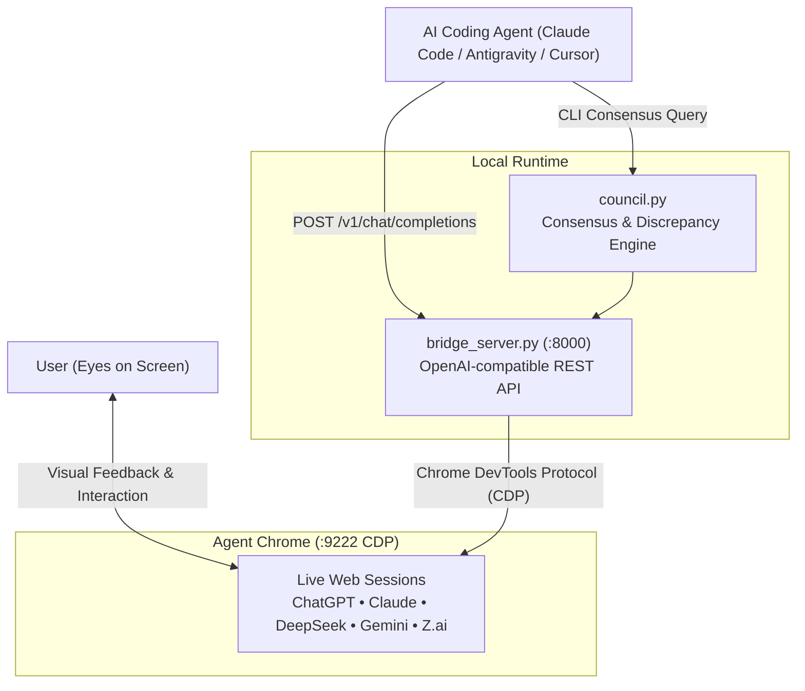

# Agent Chrome — Technical Architecture

### Key Components

1. **Dedicated User Data Dir (`~/.agent-chrome-profile`)**:
   - Completely isolated from your primary personal Chrome browsing data.
   - Preserves active logins so you never need to authenticate more than once.
   - Clean lock hygiene: never locks when closed cleanly.

2. **Chrome DevTools Protocol (CDP)**:
   - Port 9222 allows bi-directional WebSocket and HTTP control.
   - Native DOM observation without injecting heavy browser extensions.

3. **Singleton Bridge Server**:
   - Manages tab concurrency through `asyncio.Lock` per provider.
   - Prevents keystroke collisions when multiple agents or subagents query concurrently.
   - Automatic new turn detection: compares message node count and polls for settled text before returning.
